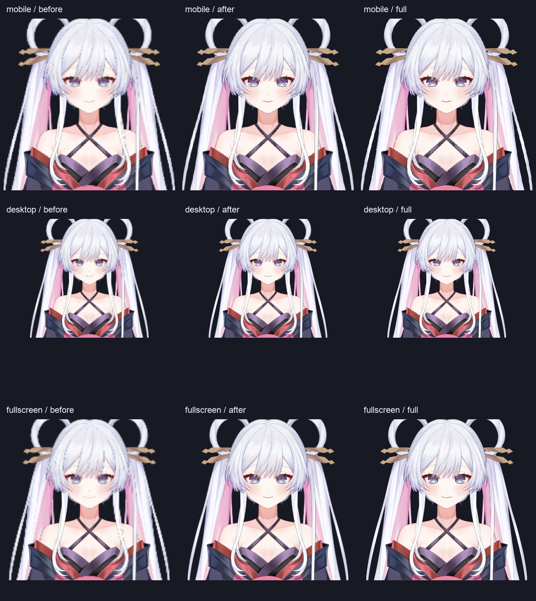

# Room Live2D 清晰度与鼠标追踪

交付版本：0.6.13+19 / v0.6.13-beta.1。

手机与桌面的默认角色画质改用 3072 纹理。普通绘制段先裁去透明边距，再在设备像素网格上局部合成：小段保留设备像素密度，超过预算的大段才降低分辨率。手机自动档每段预算从 450,000 提高到 900,000 像素；桌面维持 900,000。变形边界按网格版本缓存，动作发生后重新计算，遮罩、反向遮罩、染色及特殊混合顺序保持不变。

Room 普通舞台及角色全屏舞台均移除鼠标移动、移入和移出处理，不再用鼠标位置改变视线。自然呼吸、眨眼、口型、表情及动作继续运行；仍沿用桌面60 / 手机30fps、自适应降频及隐藏、后台、最小化暂停。

设置 → 角色与布局 → 角色画质：自动为本版高清策略；省电保留2048纹理与较低绘制预算；完整分辨率使用原始4096纹理、不限制绘制分辨率。已有用户手动选择的省电或完整分辨率设置保留。三种语言的说明同步更新。

## 原生画面对比

使用本机 macOS 原生 GPU，固定模型初始姿态与画布，对比旧绘制策略、本版自动策略和4096原始纹理直接绘制的参考。手机布局画布585×760、DPR 3；桌面730×685、DPR 2；全屏2074×929、DPR 2。手机图表示手机尺寸的原生绘制样本，不是 Android 真机截图。

基线还原 v0.6.12 的 renderer、2048纹理及手机450,000预算；其余探针条件保持相同。这是渲染策略比较，不是完整旧安装包的启动评估。基线细线探针出现245,233个不同字节，本版与原始密度参考完全一致；移动网格后旧区域透明，证明裁切跟随变形。基线JSON的 `passed:false` 表示复现了这项已知画质问题。

| 场景 | 平均RGBA像素误差，前 → 后 | 误差降低 | 本版局部合成段 / 降采样段 |
| --- | --- | --- | --- |
| 手机尺寸 | 3.132 → 1.497 | 52.2% | 4 / 1 |
| 桌面尺寸 | 2.770 → 0.835 | 69.9% | 4 / 0 |
| 全屏尺寸 | 3.570 → 1.501 | 58.0% | 4 / 1 |

误差在参考图 alpha≥128 的角色像素上计算四通道绝对差，范围0–255；它不是主观清晰度评分。每排依次为旧自动、本版自动和原始参考；裁图保留同一位置，未应用锐化。



原始数据：[旧策略](qa/live2d-clarity-v0.6.13/sharpness-before.json)、[本版策略](qa/live2d-clarity-v0.6.13/sharpness-after.json)。

## 相同负载的性能复测

Apple M5 / 16GiB / macOS27.0.1，Flutter3.47.5 Profile；窗口1280×820，角色视口760.855×571.04、DPR 2。每轮2,000条消息、200条1×1 PNG图片fixture、240段流式回复及滚动，模型同时更新，前后各三轮。基线只恢复旧renderer和2048纹理，鼠标保持静止。每轮要求窗口在前台、角色实际更新超过120次，最终每轮均更新542次。

| 轮次 | UI P95 前 → 后(ms) | Raster P95 前 → 后(ms) | 超过16.7ms帧 前 → 后 | RSS 前 → 后(MiB) |
| --- | --- | --- | --- | --- |
| 1 | 9.600 → 9.156 | 6.655 → 6.719 | 1 → 1 | 232.3 → 361.3 |
| 2 | 9.500 → 9.715 | 6.484 → 7.715 | 3 → 1 | 253.4 → 372.2 |
| 3 | 9.472 → 9.566 | 6.594 → 6.590 | 1 → 1 | 263.5 → 391.8 |

三轮UI/Raster P95均在16.7ms预算内，仍有个别超预算帧。Raster P95均值6.578 → 7.008ms，增加6.5%；不能将画质提升描述为帧耗时下降。局部合成图每帧总面积3,595,980 → 734,562像素，该数量不包含直接绘制和遮罩过绘，也不是GPU利用率。

默认两张纹理的RGBA8数据量32 → 72MiB，比原始4096的128MiB低；实际进程RSS增加，不能宣称总内存降低。本版导航后RSS367.9 / 390.1 / 393.3MiB，仅为有限三轮观测。可输入时间75 / 58 / 58ms的fixture指标不包含真实磁盘、系统密钥环或接口延迟，详见原始数据。前后三轮隐藏期间角色更新均为0。

原始数据：[基线](qa/live2d-clarity-v0.6.13/performance/room-before.json)、[本版](qa/live2d-clarity-v0.6.13/performance/room-after.json)。

## 复测与边界

```sh
flutter run --profile -d macos -t tool/verify_live2d_sharpness.dart
flutter drive --profile -d macos --driver=test_driver/performance_driver.dart --target=integration_test/room_performance_test.dart --dart-define=BENCHMARK_LABEL=local
flutter test --dart-define=RUN_CUBISM_TESTS=true test/live2d_native_test.dart test/live2d_renderer_test.dart test/live2d_scene_controller_test.dart test/live2d_blink_test.dart
```

Android发布探针使用生产默认3072纹理与900,000预算，增加细线和变形裁切验证，并继续验证遮罩、染色、混合、音频及更新接口。CI模拟器提供功能证据，不能代替手机流畅度或发热测试。用户的Android手机、9070和4060显卡未连接到本工作区；对应设备的实际画质、GPU占用和长时间内存仍需复测。iOS安装包仍需自签。
