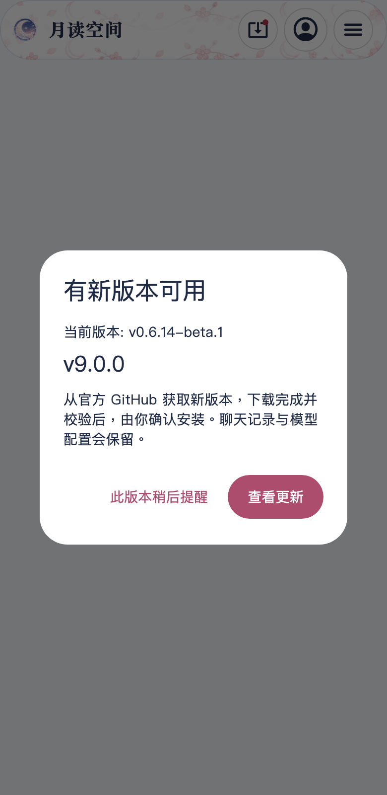

# 导航、自动更新弹窗与 Room Live2D 优化

交付版本：0.6.15+21 / v0.6.15-beta.1。

顶部品牌在登录后的窄屏中曾被更新、通知、头像和菜单挤压，四个字被省略。现在窄屏只保留更新、头像和分组菜单；通知、搜索、音乐、主题及桌面全屏仍从菜单进入。完整品牌按可用宽高缩放，窄屏不显示页面副标题。顶部导航的完整按钮布局从1160px开始，并随字体放大调整。Room 的860px舞台／聊天断点保持原逻辑。

自动更新由短暂底部提示改为弹窗，显示当前版本和新版。用户选择查看更新或稍后提醒；下载、校验和系统安装确认仍在更新页完成。应用后台、已有对话框和网站公告期间延迟显示，同一版本不重复弹窗。文章编辑和设置页显示保存提示，全局弹窗不直接跳转绕过保存／放弃检查。关闭旧弹窗只记住该弹窗的版本，不会误忽略同时查到的更新版。

全部角色场景和画质档统一限制2048纹理，包括之前保存的完整分辨率设置。两张RGBA8纹理的数据量72 → 32MiB；此数值不是实际GPU利用率或整个进程RSS。自动档每段绘制预算：手机900,000 → 450,000、桌面900,000 → 600,000；省电保留手机225,000 / 桌面450,000；细节优先也限制为900,000。设置文案提供中文、日语、英语。

待机呼吸、眨眼、口型通过模型通知直接重绘画布，不再每帧重建三层外部Transform。动作改变位移、旋转或缩放才通知变换控件；动作和表情仍实际运行。局部裁切、UV、遮罩、反向遮罩、透明度、染色及混合效果保留。沿用自动桌面60 / 手机30fps、自适应降频、鼠标追踪关闭，以及隐藏、后台和最小化暂停。

## 同机性能比较

后续补查：该1×1 PNG测试数据的IDAT校验错误，200条图片消息实际显示失败占位。本表保留原始采样，只能代表占位消息负载，不能作为实际图片解码负载证据。修正用例和有效图片采样见 [0.6.16记录](native-room-loading-v0.6.16.md)。

Apple M5 / 16GiB / macOS27.0.1，Flutter3.47.5 Profile。1280×820窗口，角色视口760.855×571.04、DPR2；2,000条消息、200条1×1 PNG图片fixture、240段流式回复和滚动，前后各三轮。基线恢复v0.6.14的场景控制器、角色舞台和renderer，其他界面及fixture保持同一套。每轮实际模型更新542次，并通过窗口焦点检查；中断或失焦的尝试不计入记录。

| 轮次 | UI P95 前 → 后(ms) | Raster P95 前 → 后(ms) | 超过16.7ms帧 前 → 后 | RSS 前 → 后(MiB) |
| --- | --- | --- | --- | --- |
| 1 | 9.475 → 9.280 | 7.114 → 6.542 | 1 → 0 | 230.3 → 221.4 |
| 2 | 9.525 → 9.522 | 6.157 → 6.809 | 1 → 0 | 226.6 → 240.4 |
| 3 | 9.082 → 9.567 | 7.484 → 6.571 | 1 → 1 | 220.8 → 244.2 |

UI和Raster三轮P95都在16.7ms内。Raster P95均值6.918 → 6.641ms；UI均值9.361 → 9.456ms。这是有限采样，不能据此宣称所有设备明显提速。进程RSS没有按纹理比例降低，本版导航后RSS为237.0 / 232.7 / 243.6MiB；仍需长时间真机观察。该桌面视口没有触发降采样，局部合成面积仍约734,562像素；较低预算主要约束更大、高DPR的角色区域。前后三轮隐藏更新均为0。

尝试跳过小绘制组的局部合成时，一轮Raster P95升至15.595ms、超预算24帧，因此撤回该实现，保留原合成路径。原始有效记录：[基线](qa/room-update-v0.6.15/room-before.json)、[本版](qa/room-update-v0.6.15/room-after.json)。

## UI 与原生验证

导航回归覆盖320、360、390、768、960、1280、1920宽度，三种语言、登录状态、更新图标及放大字体；360px中文使用3倍字体和Room的60px页头槽位。更新弹窗覆盖360px、三种语言、深浅主题、1.5倍字体及编辑状态。检查其他弹窗／后台期间的延迟、稍后提醒持久化、重复版本抑制、用户选择前不下载／不安装，以及保存检查。

真实字体的widget渲染样本采用固定登录和v9.0.0更新fixture，不是线上账号或真实发布通知：




真实Cubism测试验证默认与旧高画质设置都解码2048纹理，32MiB数据量；待机模型更新不重建外层控件，动作仍改变角色位置。macOS Release原生GPU探针验证409网格／两张2048纹理、细线和变形裁切、遮罩／染色／混合；同时复查游戏19个绘制阶段与9次重开首帧像素完全一致。

## 复测与设备边界

```sh
flutter test --dart-define=RUN_CUBISM_TESTS=true
flutter test --dart-define=RUN_UI_CAPTURE=true test/update_navigation_capture_test.dart
flutter drive --profile -d macos --driver=test_driver/performance_driver.dart --target=integration_test/room_performance_test.dart --dart-define=BENCHMARK_LABEL=local
flutter run --release -d macos -t tool/verify_mobile_live2d.dart
```

Android真机与用户的9070 / 4060未连接；本机Profile和Android软件GPU模拟器不能证明其实际帧率、发热或GPU占用。移动端默认模型30fps，页面滚动仍跟随屏幕刷新；可在设置选择模型60fps。iOS包仍需自签。升级保留账号、聊天、草稿、模型配置和游戏记录。

[发布CI](https://github.com/HelloZeroNick/tsukuyomi-space-app/actions/runs/38217178615)通过861项测试、五平台构建和Android原生探针。v0.6.15-beta.1指向生产代码3d058198696c1ccab9769ada69d3e6e03953e5cb；全部11个发布附件、2,207,741,379字节已实际下载，匹配GitHub摘要及SHA256SUMS。[CI记录](qa/room-update-v0.6.15/ci-validation.json)、[附件记录](qa/room-update-v0.6.15/release-validation.json)。
